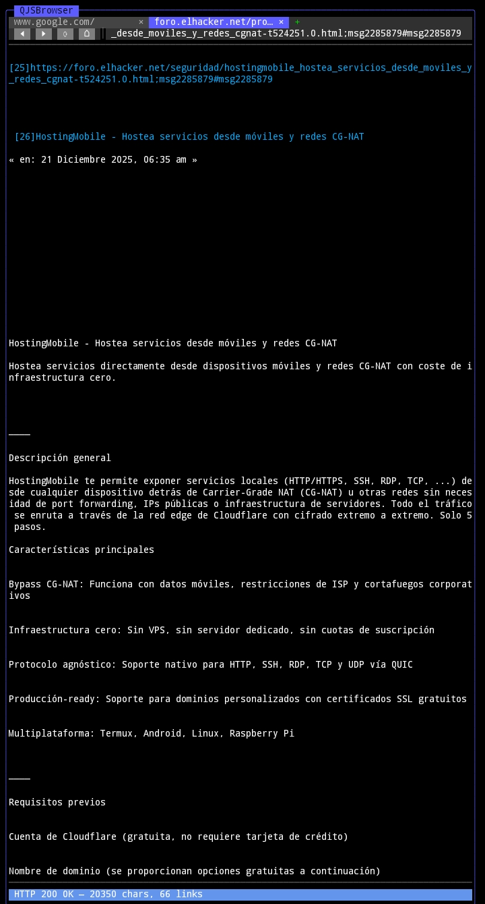

# QJSBrowser

> A web browser built from scratch, in the terminal, written mostly in JavaScript on top of QuickJS. Minimal C host, ncurses UI with a desktop-like layout, non-blocking network I/O via `epoll`, native HTTP/HTTPS with certificate validation, a mini-DOM with script execution, ES module support, a CSS engine, and images.



---

## ✨ Features

### Engine & runtime
- **Embedded JS engine** — [QuickJS](https://bellard.org/quickjs/) (Bellard), compiled into the `qjsbrowser` binary.
- **ES modules** — `<script type="module">` fully supported. An on-the-fly ESM → script transpiler plus a two-phase loader (fetch the whole graph, then execute topologically) handle static imports, dynamic `import()`, `import.meta.url`, circular dependencies, and CSS imports (injected as `<style>`). Vite and Rollup bundles load natively.
- **Script execution** — classic and module scripts, inline and external, in document order. Errors are routed to the in-TUI console (F12), never to stderr while ncurses owns the terminal.
- **Mini-DOM** — `Node`, `Element`, `Text`, `Document`, `EventTarget` with bubbling and capture. `querySelector(All)` (tag, `#id`, `.class`, `[attr]`, descendant, comma-lists), `getElementById`, `classList` (`add`/`remove`/`toggle`/`contains`), `innerHTML` (real parser, not `textContent`), `insertAdjacentHTML`, `innerText`, `textContent`, `lang`/`dir` reflection, `focus`/`blur`/`click`, `getBoundingClientRect` (zeroed — no layout), `style` proxy over the inline attribute.
- **React 18 compatible** — `MutationObserver` (stub), `MessageChannel` polyfill on microtasks, `__reactProps$*` onClick detection for click-through on `<div onClick>` cards, `history.pushState`/`popstate`/`hashchange` for SPA routing, `window.fetch` with relative-URL resolution, `URL`, `URLSearchParams`, `matchMedia` (dark-mode aware), `requestIdleCallback`, `crypto.randomUUID`.
- **CSS engine** — cascading stylesheet parser and matcher (tag, `#id`, `.class`, `[attr]`, descendant, comma-lists). Computed styles drive colors (with an ANSI-invisible-color blacklist so dark text on a dark terminal snaps to the theme color), font weight, style, decoration, heading level from `font-size`, `display: none` / `visibility: hidden`, `position: fixed` (subtree skipped), visible `border-top`/`border-bottom` (horizontal rule), `display: flex`/`grid` (children flow inline rather than block).

### Network
- **Non-blocking** — `AF_INET` sockets + `epoll`, driven from the JS event loop. Adding a new fd is one line of JS.
- **HTTP/1.0 requests** — `Host`, `Connection: close`, redirects (301/302/303/307/308, limit 10, loop detection), meta-refresh sniffing.
- **Chunked responses** — tolerated when servers ignore `Connection: close` and reply `Transfer-Encoding: chunked` anyway (common behind CDNs).
- **gzip / deflate** — transparent decompression via `lib/zlib.so`.
- **DNS** — async resolver with TTL cache, driven from `epoll` alongside the HTTP sockets.
- **HTTPS** — OpenSSL with Memory BIOs, non-blocking handshake, SNI, certificate + hostname validation against the system CA bundle. TLS 1.2 (see limitations).
- **Cookies** — persistent jar (RFC 6265 domain/path matching, `Secure`, `Max-Age`/`Expires`, ordering). Survives redirects and sessions.
- **Charset-aware decoding** — honors `Content-Type: charset=...`, sniffs UTF-8 vs Latin-1 when absent.

### Rendering
- **HTML entities** — numeric (`&#39;`, `&#x27;`) and named (`&amp;`, `&copy;`, `&mdash;`, …).
- **Rich links** — bright blue, underlined, clickable over their entire extent (not just the `[N]` marker).
- **Click-through on cards** — `<div onClick>` and `<a>` without `href` are click-detected via `__reactProps$*`; clicking anywhere on the card dispatches a real DOM click that bubbles to React's delegated listener.
- **Images** — JPEG, PNG, GIF, BMP, TGA, PSD, HDR, PIC, PNM via `stb_image`, rendered as terminal half-blocks (`▀`) with aspect-ratio preservation. SVG renders as a `[svg W×H]` placeholder.
- **Forms** — text, password, textarea, checkbox, radio, select, submit/reset/button. GET and POST, Enter-to-submit, `input` event dispatch for controlled React inputs.
- **Flex/grid awareness** — a `<div>` inside a flex/grid row is inline so navbars keep their items on one line; `<h1>`/`<p>` stay blocks so headings and paragraphs don't glue together.
- **Table layout** — `<tr>` breaks the line, `<td>`/`<th>` emit a `│` separator between cells. Forum headers render as `Nombre del foro │ Temas │ Mensajes │ Último mensaje`.
- **Horizontal rules** — emitted only for explicit `border-top`/`border-bottom` on a block; the `border` shorthand (buttons, inputs, cards) is ignored. Width tracks the terminal column count and re-serializes on resize.
- **Whitespace collapsing** — pretty-printed HTML's inter-tag `\n    ` is ignored, so pages don't render with ~20 blank lines above the navbar.

### TUI
- **Desktop-style layout** — ncursesw, 256-color palette, Unicode box-drawing, window chrome, tab bar, toolbar, status bar.
- **Tabs** — new/close/switch via keyboard (`Ctrl+T`, `Ctrl+W`) or mouse. Per-tab omnibox, page view, history, mode, status, scroll.
- **History** — per-tab back/forward (`[`, `]`), hash-aware (hash-only changes push a history entry without reloading the SPA).
- **Mouse** — click tabs, toolbar buttons, address bar, links, form controls, and card containers; wheel scrolls.
- **F12 developer console** — in-TUI JS console with history (`↑`/`↓`), `$_` for the last result, `Ctrl+L` to clear, `Esc` to close. All `console.*` output from page JS is redirected here.
- **Settings dialog** — homepage, search engine, show images, accept cookies, clear cookies, clear history, toggle the developer console. Persisted to disk.
- **Resize / resume handling** — `SIGWINCH` and `SIGCONT` (Termux app switch) trigger a full redraw with proper `resizeterm()`, eliminating stale-content ghosts.

---

## 🚀 Quick start

### Requirements

- `gcc`, `make`, `curl`, `tar`, `pkg-config`
- `libncursesw5-dev` (or equivalent; **`ncursesw`, not `ncurses`**)
- `libssl-dev` (OpenSSL ≥ 1.1.1)
- `zlib1g-dev` (for gzip/deflate decompression)
- `ca-certificates` (for TLS verification)
- A UTF-8 locale (glibc ≥ 2.35 ships `C.UTF-8` built-in)

```bash
# Debian / Ubuntu
apt install build-essential pkg-config libncursesw5-dev libssl-dev zlib1g-dev ca-certificates curl

# Alpine
apk add build-base pkgconf ncurses-dev openssl-dev zlib-dev ca-certificates curl
```

### Build

```bash
make
```

On first run, `make` automatically downloads and builds:

- **QuickJS** `2025-09-13-2` from `bellard.org`
- **qjsNetworkSockets** from GitHub (`StringManolo/qjsNetworkSockets`)
- **stb_image.h** from the `nothings/stb` repo

All three are vendored into the project tree. Subsequent builds only recompile what changed.

The `all` target compiles `qjsbrowser` plus `lib/network_sockets.so`, `lib/tui.so`, `lib/tls.so`, `lib/image.so`, `lib/zlib.so`, `lib/fs.so`, `lib/dns.so`.

### Run

```bash
./qjsbrowser
```

Every positional argument has a default under `./lib/` or `./main.js`. To override any of them:

```bash
./qjsbrowser \
  ./lib/network_sockets.so \
  ./lib/tui.so \
  ./lib/tls.so \
  ./lib/image.so \
  ./lib/zlib.so \
  ./lib/fs.so \
  ./main.js \
  ./lib/dns.so
```

### Cleanup

| Command | Effect |
|---|---|
| `make clean` | Removes binaries (`.so`, `.o`, `qjsbrowser`), keeps downloaded sources |
| `make clean-src` | Removes downloaded sources (QuickJS, qjsNetworkSockets, stb_image.h), keeps binaries |
| `make distclean` | Everything — back to "freshly cloned" state |

---

## ⌨️ Keybindings

### Global

| Key | Action |
|---|---|
| `Ctrl+C` | Quit |
| `Ctrl+T` | New tab |
| `Ctrl+W` | Close current tab (in page mode) |
| `Tab` | Toggle between address bar and page |
| `F12` | Toggle developer console |

### Omnibox mode

| Key | Action |
|---|---|
| `Enter` | Navigate |
| `Esc` | Back to page mode |
| `←` / `→` / `Home` / `End` | Move cursor |
| `Backspace` / `Delete` | Delete character |
| `Ctrl+U` / `Ctrl+L` | Clear line |
| `Ctrl+W` | Delete word |

### Page mode

| Key | Action |
|---|---|
| `j` / `↓` | Scroll down |
| `k` / `↑` | Scroll up |
| `Space` | Page down |
| `b` | Page up |
| `1`–`9` | Follow link N |
| `[` / `]` | Back / forward |
| `r` | Reload |
| `g` / `:` | Edit URL |
| `x` | Stop loading |
| `q` | Quit |
| `Tab` | Focus next form field (or address bar) |
| `Enter` | Submit form / press focused button |
| `Esc` | Blur focused field |

### Console (F12)

| Key | Action |
|---|---|
| `Enter` | Evaluate |
| `↑` / `↓` | History |
| `Ctrl+L` | Clear output |
| `Esc` | Close console |
| `$_` | Last result (in expressions) |

### Mouse

| Action | Result |
|---|---|
| Click tab | Activate it |
| Click `×` on a tab | Close it |
| Click `+` | New tab |
| Click `◀` `▶` `⟳` `⌂` | Toolbar actions |
| Click address bar | Focus omnibox |
| Click anywhere on a link or card | Follow it |
| Click form control | Focus / toggle |
| Wheel up/down | Scroll page |

---

## 🏛️ Architecture

Four strict layers. Only the top one changes to add features.

```
┌──────────────────────────────────────────────────────────────┐
│  main.js + src/**/*.js                                       │
│  ▸ Event loop (while + net.epoll_wait)                       │
│  ▸ HTTP client (fetch, TLS handshake, redirects, cookies,    │
│    gzip, chunked, meta-refresh)                              │
│  ▸ DNS resolver, timers, scheduler                           │
│  ▸ HTML parser → DOM tree → CSS matcher → text segments      │
│  ▸ ESM transpiler + loader (static + dynamic imports)        │
│  ▸ Script execution (inline + external + modules)            │
│  ▸ Mini-DOM: Node/Element/Text/Document, events, classList   │
│  ▸ Widgets (tab bar, toolbar, omnibox, page view, status,    │
│    settings dialog, console, image view, form render)        │
│  ▸ Tab manager + per-tab state                               │
│  ▸ Controller (input routing, mouse, modes)                  │
├──────────────────────────────────────────────────────────────┤
│  lib/*.so — C primitives, dlopen'd                           │
│  ▸ network_sockets   syscalls + epoll                        │
│  ▸ tui               ncursesw wrapper, colors, mouse, images │
│  ▸ tls               OpenSSL Memory BIOs                     │
│  ▸ image             stb_image decoder                       │
│  ▸ zlib              inflate (gzip / deflate)                │
│  ▸ fs                file read/write                         │
│  ▸ dns               async resolver (same epoll loop)        │
├──────────────────────────────────────────────────────────────┤
│  qjsbrowser (C host, ~300 lines)                             │
│  ▸ setlocale + ensure_utf8_locale                            │
│  ▸ JSRuntime / JSContext                                     │
│  ▸ JS_SetModuleLoaderFunc → loads .so and .js                │
│  ▸ Runs main.js, drains jobs, exits                          │
└──────────────────────────────────────────────────────────────┘
```

### Why this split

- **`-rdynamic`** exports the `JS_*` symbols from the executable. The `.so` modules are loaded with `dlopen` and resolve `JS_NewObject`, `JS_ToCString`, etc. from the host. They never link QuickJS themselves, avoiding duplicate runtimes in memory.
- **The event loop lives in JS.** `net.epoll_wait` is a syscall exposed as a function; the `while (running) { ... }` is in `main.js`. Adding a new fd (tab, parallel request, DNS query, timer) is one line of JS.
- **Binary safety across the JS/C boundary.** TLS ciphertext, socket reads/writes, and `Uint8Array` interop use `JS_NewArrayBufferCopy` / `JS_GetArrayBuffer` (not `JS_NewStringLen`), so multibyte sequences survive round-trips.
- **Per-tab state.** Each tab owns its omnibox, page view, history, mode, status, scroll, and serialized segments. The HTTP client tags every connection with `options.tabId`; callbacks route responses to the right tab even after redirects.
- **Mutation batching.** DOM writes are batched (`beginMutationBatch` / `endMutationBatch`) so React's commit-then-repaint cycle doesn't re-serialize the DOM N times per flush.
- **pumpJobs at end of handleInput, not inside dispatch.** React 18 classifies `input`/`change` as ContinuousEventPriority (scheduled via MessageChannel, not flushSync). Pumping inside the dispatch would re-enter React mid-flush; pumping after all handlers return is safe and lets the commit complete in the same frame.

---

## 📁 Project layout

```
QJSBrowser/
├── main.js                         # entry point: wires everything + event loop
├── Makefile
├── c/
│   ├── main.c                      # host: dlopen + QuickJS init + loader
│   ├── tui.c                       # ncursesw wrapper + color + mouse + images
│   ├── tls.c                       # OpenSSL wrapper (Memory BIOs)
│   ├── image.c                     # stb_image decoder (JPEG/PNG/GIF/...)
│   ├── zlib.c                      # gzip/deflate inflate
│   ├── fs.c                        # file read/write
│   └── dns.c                       # async resolver via epoll
├── lib/                            # artifacts (git-ignored)
│   ├── network_sockets.so
│   ├── tui.so
│   ├── tls.so
│   ├── image.so
│   ├── zlib.so
│   ├── fs.so
│   └── dns.so
├── scripts/
│   ├── install.sh
│   └── testSocketLib.sh
├── src/
│   ├── base/
│   │   ├── url.js                  # parseUrl, resolveUrl, normalizeUrl
│   │   ├── keys.js                 # key map (ASCII + ncurses)
│   │   ├── timers.js               # setTimeout/setInterval driven by the loop
│   │   └── scheduler.js            # microtask queue + deferred work
│   ├── net/
│   │   ├── http-parser.js          # parseHttpResponse, isRedirect
│   │   ├── http-client.js          # non-blocking fetch + TLS + redirects + cookies
│   │   └── cookies.js              # RFC 6265 jar, persisted via fs.so
│   ├── dom/
│   │   ├── nodes.js                # Node / Element / Text / Document, selectors
│   │   ├── events.js               # Event / CustomEvent / EventTarget
│   │   └── mutation-hook.js        # batched DOM change notifications
│   ├── css/
│   │   ├── parser.js               # stylesheet + inline-style parser
│   │   ├── matcher.js              # selector matching + specificity
│   │   ├── color.js                # CSS color → ANSI snap
│   │   └── defaults.js             # user-agent default styles
│   ├── content/
│   │   ├── html-entities.js        # named + numeric entity decoder
│   │   ├── html-to-text.js         # legacy pre-DOM text parser (unused)
│   │   ├── html-to-dom.js          # HTML → DOM tree, <script> capture
│   │   ├── dom-to-text.js          # DOM → rich segments + links + images
│   │   ├── script-runner.js        # inline + external + module execution
│   │   ├── esm-transpiler.js       # ESM → plain script (imports/exports)
│   │   └── esm-loader.js           # fetch graph, topo-execute, CSS injection
│   ├── browser/
│   │   ├── controller.js           # input routing, mouse, navigation
│   │   ├── globals.js              # window, location, history, fetch, stubs
│   │   ├── dom-globals.js          # install document, EventTarget on global
│   │   ├── form-state.js           # per-tab form state, tab-order, cursor
│   │   ├── history.js              # back/forward stack
│   │   ├── settings.js             # persistent settings (JSON via fs.so)
│   │   ├── tab.js                  # per-tab state factory
│   │   └── tab-manager.js          # tabs collection + active index
│   └── ui/
│       ├── theme.js                # 256-color palette
│       ├── window.js               # window chrome helper
│       ├── tab-bar.js              # clickable tab bar
│       ├── toolbar.js              # back / forward / reload / home
│       ├── omnibox.js              # address bar state machine
│       ├── page-view.js            # rich-segment rendering with scroll
│       ├── form-render.js          # form controls → segments
│       ├── image-view.js           # half-block image rendering
│       ├── settings-dialog.js      # modal settings menu
│       ├── status-bar.js           # bottom status line
│       └── console.js              # F12 developer console
└── tests/
    └── js/
        ├── testReact/
        │   ├── reactNoCrash/index.html
        │   └── reactRealApp/index.html
        └── testScripts/index.html
```

`controller.js` and `main.js` are the largest JS files (~600–800 lines); everything else is 100–400 lines. To add a feature (e.g. find-in-page), create `src/ui/find-bar.js` + wire it in `controller.js`.

---

## 🛠️ Development

### Modifying a JS module

Just edit the file. No C rebuild needed.

```bash
./qjsbrowser
```

If a module fails to load, you'll see it in the F12 console (after `hookConsole` runs) or on `stderr` (during bootstrap, before `hookConsole`):

```
[loader] cannot read module: <path>
```

To capture stderr without corrupting the ncurses UI, redirect to a file:

```bash
./qjsbrowser 2>debug.log &   # in another terminal: tail -f debug.log
```

### Adding a new syscall / primitive

1. Add the C function to the relevant `.so` (`c/tui.c`, `c/tls.c`, etc.).
2. Register it in the module's `JSCFunctionListEntry` array.
3. `make lib/tui.so` (only that `.so` is recompiled).
4. Call it from JS: `tui.newFunction(...)`.

### Adding a new UI widget

1. Create `src/ui/my-widget.js` exporting a factory function.
2. It receives `(tui, theme)` and returns an object with `render(...)` and optionally `hitTest(x, y)`.
3. Instantiate it in `controller.js` and call its `render` from the main `render()`.
4. For click support, call its `hitTest` from `handleMouse` before falling through to page click.

### Debugging DOM/CSS

Load `http://localhost:8000/test-react-real-app.html` (served from a local HTTP server) to test React rendering. Open F12 to watch console output. Useful probes:

```js
// A paragraph's resolved color
document.querySelectorAll('p')[3].getAttribute('style');

// A link's href after resolution
document.querySelectorAll('a').forEach(a => console.log(a.getAttribute('href')));

// Force a fetch to a relative URL
fetch('/api/data.json').then(r => r.json()).then(console.log);
```

---

## ⚠️ Known limitations

| Area | Status | Notes |
|---|---|---|
| **ESM top-level `await`** | ❌ | Requires native `import()` in C (path B) or a real parser. |
| **ESM live bindings** | ❌ | Snapshotted at module init. Vite/Rollup avoids this via inlining. |
| **HTTP/1.1 keep-alive** | ❌ | Requests use `Connection: close`. Chunked responses are handled, but connections are not reused. |
| **HTTP/2, HTTP/3** | ❌ | Always negotiates HTTP/1.x. No ALPN. |
| **TLS 1.3** | ⚠️ | Capped to TLS 1.2 over Memory BIOs. |
| **CSS layout** | ❌ | No real box model. `margin`, `padding`, `width`, `height`, `box-sizing`, and `position` (other than skipping `fixed`) are ignored. `display: flex`/`grid` only trigger "children flow inline" for `<div>`; no grid or flex algorithm. |
| **CSS variables** | ❌ | `var(--x)` not resolved. |
| **CSS media queries** | ❌ | Not parsed. |
| **CSS pseudo-classes** | ❌ | `:hover`, `:focus`, `:nth-child`, etc. not matched. |
| **CSS combinators** | ⚠️ | Only descendant (` `). `>`, `+`, `~` are not supported by `matcher.js`. |
| **CSS transforms / transitions / animations** | ❌ | Ignored. |
| **SVG** | ⚠️ | Rendered as a `[svg W×H]` text placeholder. NanoSVG integration pending. |
| **WebP, AVIF, HEIC, JPEG-XL** | ❌ | Only formats supported by `stb_image` (JPEG, PNG, GIF, BMP, TGA, PSD, HDR, PIC, PNM). |
| **Canvas** | ⚠️ | `getContext` returns a stub proxy that swallows all calls. No drawing. |
| **Web Audio** | ⚠️ | Stub `Audio` class. `play()` resolves immediately. |
| **localStorage / sessionStorage** | ⚠️ | In-memory only. Cleared on exit. Cookies persist, storage does not. |
| **`fetch()` streaming** | ❌ | Body fully buffered. No `ReadableStream`, no `AbortController`, no fully spec'd `Request`/`Response`. |
| **`URL`** | ⚠️ | Not fully spec-compliant. Percent-encoding normalization is partial. |
| **Web Workers** | ❌ | No separate `JSContext`. |
| **WebAssembly** | ❌ | Not exposed. |
| **Shadow DOM, Custom Elements** | ❌ | Not implemented. |
| **IFrames** | ❌ | Not rendered. |
| **`<input type="file">`** | ❌ | No file picker. |
| **`<textarea>` multi-line cursor** | ⚠️ | Cursor moves left/right; up/down not wired. |
| **`enctype="multipart/form-data"`** | ❌ | Only `application/x-www-form-urlencoded`. |
| **Video / audio playback** | ❌ | No decoder wired. |
| **Visited-link colors** | ❌ | No per-URL visited state yet. `theme.pairs.visited` exists but unused. |
| **Tab overflow** | ⚠️ | Tabs beyond the width limit are not drawn. Close with `×`. |
| **Binary body downloads** | ⚠️ | Body is decoded as text. Saving a file would need `Uint8Array` downstream of the decoder. |
| **Image sizing** | ⚠️ | Only HTML `width`/`height` attributes are read. CSS class-based sizes are ignored, so retina-served images (avatars, icons) render larger than their CSS display size. Fix planned. |

---

## 🗺️ Roadmap

In impact order:

1. **Image sizing** — honor `width`/`height` from CSS (class or inline), not just HTML attributes, so avatars and icons match their CSS display size instead of filling the terminal.
2. **NanoSVG integration** — rasterize inline `<svg>` and `` in `image.so`, replacing the `[svg W×H]` placeholder. Requires a DOM→XML serializer.
3. **WebP** — link `libwebp` into `image.so`, detect RIFF/WEBP magic, decode. ~30 lines of C.
4. **Top-level `await` + live bindings** — extend the transpiler or expose `import()` natively via `JS_SetModuleLoaderFunc`.
5. **CSS variables + media queries + pseudo-classes** — resolve `var(--x)` in `matcher.js`; parse `@media (prefers-color-scheme: dark)`; match `:hover`/`:focus`/`:nth-child`.
6. **CSS flex/grid layout** — a minimal row/column flex resolver and a grid-columns splitter. Turns navbars and product grids into real layout instead of stacked blocks.
7. **CSS combinators** — `>`, `+`, `~` in `matcher.js`.
8. **localStorage persistence** — write to disk between sessions.
9. **HTTP/1.1 keep-alive** — reuse connections for same-host requests.
10. **Streaming chunked** — incremental parser so the page starts rendering before the full response arrives.
11. **HTTP/2 via ALPN** — large jump; requires HPACK and frame demux.
12. **TLS 1.3** — switch `tls.so` to a different handshake strategy or wait for OpenSSL's `key_share` over Memory BIOs to stabilize.
13. **Find in page** — `Ctrl+F` opens a find-bar widget, highlights matches in the pageView.
14. **Bookmarks** — persistent list, `Ctrl+D` to add, `:bookmarks` to open.
15. **Downloads** — save response body as a file via `fs.so`.
16. **Multiple windows** — vertical split of the page area, one tab in each pane.

---

## 🤝 Testing

Three HTML fixtures live under `tests/js/`:

- **`testScripts/index.html`** — classic script execution, DOM manipulation, event handlers.
- **`testReact/reactNoCrash/index.html`** — minimal React render (checks that React mounts and commits without crashing).
- **`testReact/reactRealApp/index.html`** — buttons + controlled input + list (checks state updates propagate through `pumpJobs` and `flushSync` interactions).

Serve them from any local HTTP server (`python3 -m http.server 8000` from `tests/js/`) and load `http://localhost:8000/testReact/reactRealApp/index.html` in QJSBrowser. Also worth testing against:

- `https://example.com` — classic HTML with an inline script, `<svg>`, and `insertAdjacentHTML`.
- `https://calculator-stringmanolo.netlify.app` — React app with an `innerText` click handler.
- `https://stringmanolo.qzz.io` — Vite SPA with hash routing, dynamic `import()`, and CSS-driven layout.

---

## 📝 Changelog summary

Notable additions and fixes since the initial release (grouped by feature):

**Core engine and scripting**
- `browser globals, timers, minimal DOM` — the `window`, `setTimeout`, and basic `document.createElement` stubs.
- `Html to dom` — real HTML parser producing a tree instead of text.
- `Live dom render` — the DOM lives between navigation and drives the rendered output.
- `Read <script>` — inline and external classic scripts are executed.
- `Make React dont crash`, `Basic React support`, `Basic react working`, `Load most of react code` — progressive React 18 compatibility (MessageChannel microtasks, event dispatch on `__reactProps$*`, `pumpJobs` after handleInput).
- **ES module support** — transpiler + loader for Vite/Rollup bundles, circular imports, dynamic `import()`, `import.meta.url`.
- `Fixed dinamic modules load + clicable elements` — dynamic `import()` resolution and click-through on `<div onClick>` cards.
- `More support for React` — `innerHTML` setter (real parser), `innerText`, `insertAdjacentHTML`, `lang`/`dir` reflection.

**Network and storage**
- `Add cookies`, `cookies persistence` — RFC 6265 jar, saved to disk.
- `Add tls and Readme`, `Fix tls and redirects` — HTTPS with certificate validation.
- `Add gzip support` — `lib/zlib.so` decompresses gzip/deflate.
- `Fix charcter decoding` — content-type charset awareness, UTF-8 vs Latin-1 sniffing.

**UI**
- `Complete UI redesign` — window chrome, tab bar, toolbar, status bar.
- `Add tabs`, `Add mouse support` — clickable tabs, toolbar, address bar, links.
- `Add link rendering` — bright blue, entire extent clickable.
- `Add settings UI and cookies persistence` — modal dialog.
- `Full console` — F12 in-TUI JS console with history.
- `Add form support` — all standard controls, GET + POST, Enter-to-submit.
- `Add image support` — `lib/image.so` via stb_image, half-block rendering.
- `Fix images overlapping menu, by disable them` — images skipped while settings dialog is open.

**CSS and rendering**
- `Fix svg redirect bug, and css`, `Fix on css`, `Fix some css issues` — CSS parser/matcher, color snapping, invisible-color blacklist, flex/grid awareness for navbars, table `│` separators, border-bottom horizontal rules with dynamic width.
- `Fix whitespace problem` — skip inter-tag `\n    ` text nodes so pages don't render with ~20 blank lines above the navbar.

**Navigation**
- `Add history` — per-tab back/forward.
- `Fixed hash urls`, `Fix hash urls not being added to history` — hash-only changes update the URL and push a history entry without reloading the SPA.

**Robustness**
- `Fix visual bug on SIGCONT/SIGWINCH` — `tui.check_resize()` triggers full redraw after app switch or window resize, no more stale-content ghosts.

---

## 📄 License

See `LICENSE` in the repository root (QuickJS is MIT; `stb_image.h` is public domain / MIT dual; the rest of the project follows the repo's chosen license).